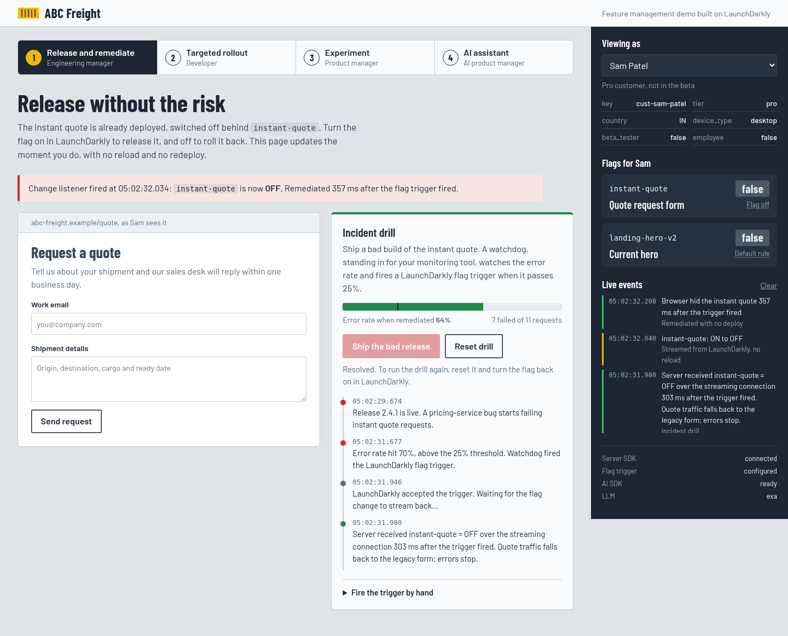
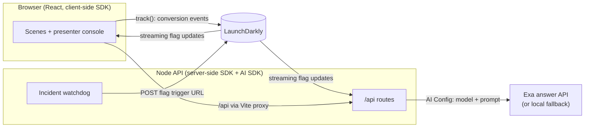
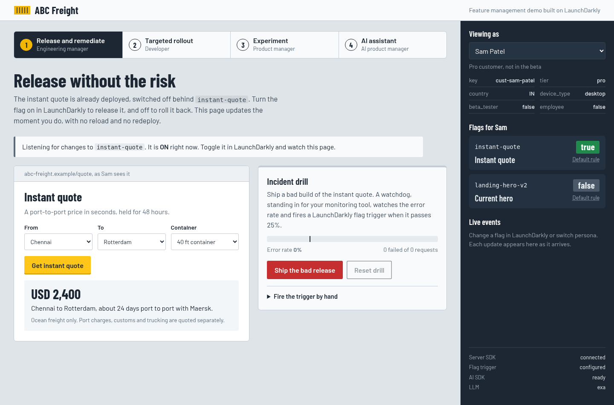
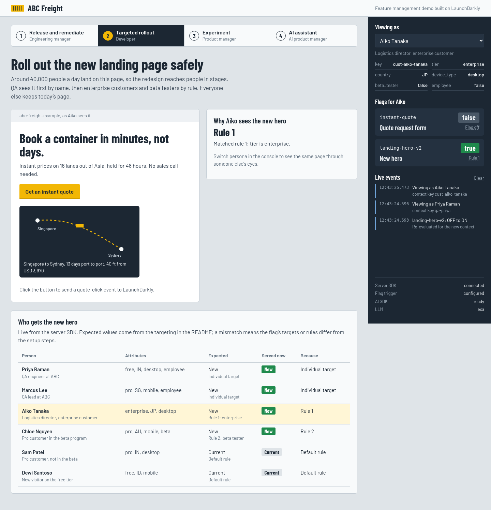
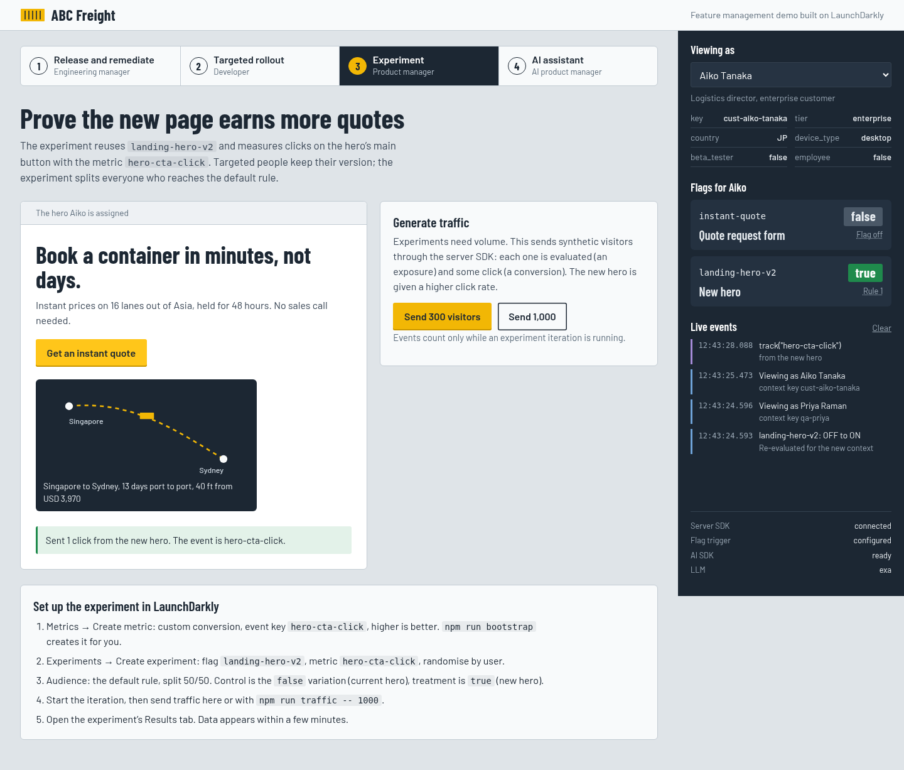
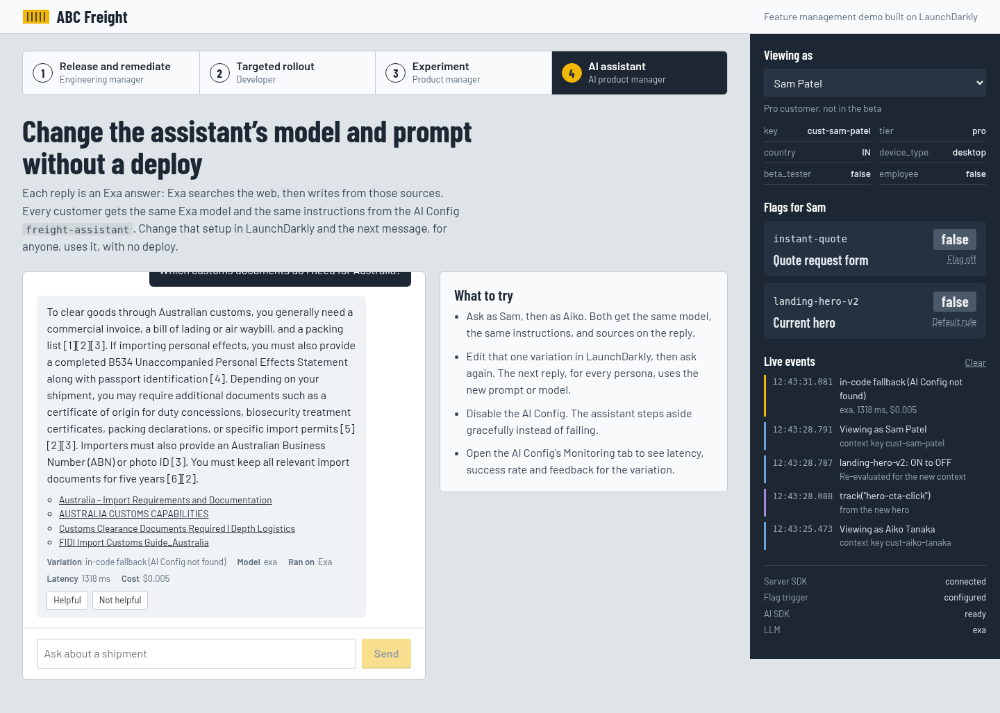

# ABC Freight × LaunchDarkly

A working demo of how LaunchDarkly lets a team ship faster without shipping more risk. ABC Freight is a fictional ocean-freight company. Its web app has four scenes, one for each part of the exercise, plus a presenter console that shows who you are, what LaunchDarkly is serving you and why, and every flag change as it streams in.

| Scene | Persona | What it shows |
|---|---|---|
| 1. Release and remediate | Engineering manager | A new instant quote ships dark, is released and rolled back from LaunchDarkly with no reload, and is switched off automatically by a flag trigger when a bad release spikes the error rate. |
| 2. Targeted rollout | Developer | A redesigned landing page hero reaches QA by name, then enterprise customers and beta testers by rule, while everyone else falls through to today’s page. |
| 3. Experiment *(extra credit A)* | Product manager | The same flag runs an experiment against a click metric, with a traffic generator so the results UI has data. |
| 4. AI assistant *(extra credit B)* | AI product manager | A shipping assistant that answers with Exa. One model and one prompt, from an AI Config, served to every customer and swappable without a deploy. |



---

## Contents

- [Requirement map](#requirement-map)
- [Architecture](#architecture)
- [What you need](#what-you-need)
- [Quick start (about 10 minutes)](#quick-start-about-10-minutes)
  - [Option A: automated setup](#option-a-automated-setup)
  - [Option B: manual setup](#option-b-manual-setup)
- [Running the demo](#running-the-demo)
- [Extra credit setup](#extra-credit-setup)
- [Quote figures](#quote-figures)
- [Configuration reference](#configuration-reference)
- [Project structure](#project-structure)
- [Troubleshooting](#troubleshooting)
- [Assumptions and design decisions](#assumptions-and-design-decisions)

---

## Requirement map

Every requirement in the exercise, where to see it, and the code that does it.

| Requirement | Where to see it | Code |
|---|---|---|
| **Part 1:** feature behind a flag | Scene 1, the quote widget | `web/src/scenes/ReleaseScene.jsx` (`InstantQuote` vs `QuoteRequestForm`) |
| Toggle ON releases, OFF rolls back, no redeploy | Turn `instant-quote` on and off in LaunchDarkly | same file; the server also gates the API (`server/src/index.js`, `POST /api/quote`) |
| SDK listener, instant switch, no reload | The banner above the widget and the console’s live events | `ldClient.on('change:instant-quote', …)` in `ReleaseScene.jsx`; global `ldClient.on('change', …)` in `web/src/App.jsx` |
| Remediate with a flag trigger | “Ship the bad release” in the incident drill, or `curl` | `server/src/incident.js` (watchdog POSTs to the trigger URL) |
| **Part 2:** flag around a component | Scene 2, the landing page hero | `web/src/components/LandingHero.jsx`, `TargetingScene.jsx` |
| Context with attributes | Console, “Viewing as” | `web/src/personas.js` (`tier`, `country`, `device_type`, `beta_tester`, `employee`, `account_age_days`) |
| Individual targeting | Priya and Marcus (QA) | Flag targets `qa-priya`, `qa-marcus` |
| Rule-based targeting | Aiko (enterprise), Chloe (beta) | Rules `tier is enterprise`, `beta_tester is true` |
| Default rule for everyone else | Sam and Dewi | Default rule serves `false` |
| **Extra A:** metric and experiment | Scene 3 | `ldClient.track('hero-cta-click')` in `LandingHero.jsx`; traffic in `server/src/traffic.js` |
| **Extra B:** AI Config, one Exa model and prompt for everyone, swappable without a deploy | Scene 4 | `server/src/assistant.js` (AI SDK), `server/src/llm.js` (Exa answer API) |
| AI quality metrics | Reply footer; AI Config Monitoring tab | `trackDuration`, `trackSuccess`, `trackError`, `trackFeedback` in `assistant.js` |

---

## Architecture



Two SDKs, on purpose. The browser uses the **client-side ID** and the React SDK, so the UI reacts the instant a flag changes. The server uses the **SDK key** and the Node server SDK, so the API enforces the same flag (a stale tab can’t call a disabled feature) and so the AI Config, experiment traffic and audience table run where secrets live.

The API opens its port before the server SDK finishes connecting, and the Vite dev server retries `/api` until that port is up. The first page load does not fail just because LaunchDarkly is still connecting. Flag keys, the experiment metric, and the AI Config key live in `shared/flags.js`. The quote form and the pricing API share the port and container lists in `shared/lanes.js`.

---

## What you need

- **Node.js 20 or newer** and npm (bundled with Node). Check with `node -v`.
- **A LaunchDarkly account.** A free trial works: <https://launchdarkly.com/start-trial>.
- macOS, Linux or Windows (WSL or PowerShell). Ports **5173** (web) and **3001** (API) free.
- Internet access from your machine to LaunchDarkly. Corporate proxies that block streaming connections (`*.launchdarkly.com`) will stop live updates.
- Optional: an Exa API key for live web-backed answers in scene 4. Without one, a local fallback answers, so the demo runs end to end at no cost.

---

## Quick start (about 10 minutes)

```bash
git clone <this-repo-url> abc-freight-launchdarkly
cd abc-freight-launchdarkly
npm install          # installs the server and web workspaces
cp .env.example .env
```

Then configure LaunchDarkly with **one** of the two options below, and start the app:

```bash
npm run dev          # checks your .env, then starts API (:3001) and web (:5173)
```

Open <http://localhost:5173>. The console on the right shows the LaunchDarkly connection under **Health** and the flags served to the current persona.

### Option A: automated setup

Fastest. A script creates everything through the LaunchDarkly REST API and writes the keys into `.env`.

1. In LaunchDarkly, go to **Account settings → Authorization** and create an **access token** with the **Writer** role.
2. In `.env`, set:
   - `LD_API_TOKEN` to that token
   - `LD_PROJECT_KEY` and `LD_ENVIRONMENT_KEY` to the project and environment you want to use. A new trial is usually `default` and `production`.
3. Run:

   ```bash
   npm run bootstrap
   ```

The script fills `LD_SDK_KEY`, `VITE_LD_CLIENT_SIDE_ID` and `LD_TRIGGER_URL`, and creates both flags with targeting, the trigger, and the experiment metric. It is safe to run again: anything that already exists is left alone, including variation names on a flag you created yourself. The experiment and the AI Config stay manual because they are better shown in the UI; see [Extra credit setup](#extra-credit-setup).

### Option B: manual setup

Everything the script does, by hand. Use the same **project and environment** throughout.

**1. Keys.** Go to **Project settings → Environments → your environment** and copy:

| Copy | Paste into `.env` as |
|---|---|
| SDK key (starts with `sdk-`) | `LD_SDK_KEY` |
| Client-side ID (24 characters) | `VITE_LD_CLIENT_SIDE_ID` |

**2. Flag `instant-quote` (Part 1).** Create a flag:

| Field | Value |
|---|---|
| Name / key | Instant quote / `instant-quote` |
| Type | Boolean. Optional variation names: `true` “Instant quote (new)”, `false` “Quote request form (legacy)”. |
| Client-side SDK availability | **Tick “SDKs using Client-side ID”** |
| Default rule | serve `true` |
| Off variation | `false` |
| State | **Leave it OFF.** Turning it on is the first demo moment. |

**3. Flag trigger on `instant-quote`.** Open the flag and find **Triggers** (in the flag’s settings). Add a trigger: **Generic trigger**, action **Turn flag off**. Copy the URL into `LD_TRIGGER_URL`. LaunchDarkly shows it only once; if you lose it, reset the URL from the same place.

**4. Flag `landing-hero-v2` (Part 2).** Create a flag:

| Field | Value |
|---|---|
| Name / key | Landing page hero v2 / `landing-hero-v2` |
| Type | Boolean. Optional variation names: `true` “New hero (v2)”, `false` “Current hero”. |
| Client-side SDK availability | **Tick “SDKs using Client-side ID”** |
| Individual targets | Serve `true` to context kind **user**, keys `qa-priya` and `qa-marcus` |
| Rule 1 | If **user** `tier` **is one of** `enterprise`, serve `true` |
| Rule 2 | If **user** `beta_tester` **is one of** `true` (boolean), serve `true` |
| Default rule | serve `false` |
| State | **ON** |

Rule order matters only for the label the console shows (“Rule 1”, “Rule 2”).

**5. Restart `npm run dev`** after any change to `.env`. Vite reads it only at startup.

To confirm the setup, open scene 2. The “Who gets the new hero” table lists what each persona should see; a **check setup** marker means a target or rule differs from the steps above.

---

## Running the demo

Use the persona picker in the console (right) to switch contexts. Every switch calls `ldClient.identify()` and the page re-evaluates for that person. For a full live talk track, see [`docs/demo-script.md`](docs/demo-script.md).

**Scene 1: Release and remediate.** With LaunchDarkly open beside the app:

1. Turn `instant-quote` **ON**. The legacy request form becomes the instant quote, the banner shows the change listener firing, and the console logs the streamed change. Get a quote: USD 2,400 for Chennai to Rotterdam, 40 ft, about 24 days port to port with Maersk.
2. Turn it **OFF**. Instant rollback, no reload.
3. Turn it **ON** again, then click **Ship the bad release**. Synthetic traffic starts failing; at a 25% error rate the watchdog fires the flag trigger; the flag turns off, the server and browser both receive it, and the banner reports how many milliseconds remediation took after the trigger fired.
4. To fire the trigger yourself instead (or if `LD_TRIGGER_URL` is unset), run:

   ```bash
   curl -X POST "<your LD_TRIGGER_URL>"
   ```

   To rerun the drill: **Reset drill**, then turn the flag back on.



**Scene 2: Targeted rollout.** Switch between personas and watch the hero and the explanation change:

| Persona | Key | Sees | Why |
|---|---|---|---|
| Priya Raman, QA | `qa-priya` | New | Individual target |
| Marcus Lee, QA | `qa-marcus` | New | Individual target |
| Aiko Tanaka, enterprise | `cust-aiko-tanaka` | New | Rule 1: `tier` is enterprise |
| Chloe Nguyen, beta | `cust-chloe-nguyen` | New | Rule 2: `beta_tester` is true |
| Sam Patel, pro | `cust-sam-patel` | Current | Default rule |
| Dewi Santoso, free | `visitor-dewi-s` | Current | Default rule |

Edit a rule in LaunchDarkly, for example add `pro` to rule 1. The audience table updates within a few seconds.

The hero button records a click. A line under the hero confirms it, and Live events shows `track("hero-cta-click")`. It does not open a quote. The priced quote is scene 1.



**Scene 3: Experiment.** Same flag, `landing-hero-v2`, measured by `hero-cta-click`. Click the hero button once, then **Send 300 visitors** or **Send 1,000**. Open the experiment’s Results tab in LaunchDarkly. Events count only while an iteration is running. The traffic is synthetic, so read the setup and the results screen, not the number as a real winner.



**Scene 4: AI assistant.** Ask a question. Exa searches, answers, and lists sources under the reply. Every persona gets the same model and the same instructions. Edit that one variation in LaunchDarkly and ask again: the next reply, for anyone, uses the new setup. The footer shows the variation, the model, where the answer ran, latency, and what Exa charged for the answer.



---

## Extra credit setup

### A: Experiment

1. **Metric.** Created by `npm run bootstrap`. By hand: **Metrics → Create metric**, custom conversion, event key `hero-cta-click`, randomization unit user, success when higher than baseline.
2. **Experiment.** **Experiments → Create experiment**: flag `landing-hero-v2`, metric `hero-cta-click`, randomize by user. Audience: the **default rule**, split 50/50. Control is the `false` variation (current hero), treatment is `true` (new hero).
3. **Start** the iteration.
4. Send traffic from scene 3 (**Send 300 visitors** or **Send 1,000**) or from a terminal:

   ```bash
   npm run traffic -- 1000
   ```

5. Open the experiment’s results. Data appears within a few minutes. Simulated visitors carry `simulated: true`, so you can exclude them with a rule later.

The aim is to show setup and the results UI, not a conclusive result. The simulator gives the new hero a higher click rate (16% vs 10%) so the trend is visible.

### B: AI Config

LaunchDarkly now calls AI Configs **AgentControl**. The API and the AI SDK are unchanged, so the code still says AI Config.

1. In the left sidebar, open **Agent management → Agents** and create a config with key `freight-assistant` in **completion** mode.
2. Add a custom model for Exa. On the variation, open **Select a model → + Add a model** and fill in the “Add custom model” dialog:

   | Field | Value |
   |---|---|
   | Name | `Exa` |
   | Provider | Custom |
   | Model ID | `exa` (or `exa-pro`, `exa-research`, `exa-fast`) |
   | Token costs | `0`. Exa bills per answer, not per token. |

3. Add one variation and serve it to everyone:

   | Variation | Model | System message |
   |---|---|---|
   | `shipping` | `Exa` (model ID `exa`) | `You are ABC Freight's shipping assistant. Answer in one or two sentences from the sources. The customer is {{customer_name}} on the {{tier}} plan.` |

4. **Targeting:** default rule → `shipping`. No persona rules. Turn targeting **on**.
5. Optional: `EXA_API_KEY` in `.env` sends that prompt to Exa and attaches sources. Create a key at <https://dashboard.exa.ai/api-keys>. The model ID is sent to Exa unchanged when it is one of `exa`, `exa-pro`, `exa-research` or `exa-fast`; any other model ID falls back to `exa`. Without the key, the local fallback answers with the same prompt for every customer. Restart `npm run dev` after changing `.env`.

In scene 4, ask as Sam, then as Aiko. The footers match. Edit the variation in LaunchDarkly and ask again: both personas get the new prompt or model on the next message. Latency, success or error, and thumbs up/down feedback are recorded against the variation and appear on the config’s Monitoring tab. Token counts are not sent, because Exa’s answer API does not report them; the reply footer shows Exa’s cost per answer instead.

---

## Quote figures

The instant quote is a rate card, not a live pricing feed. `server/src/quotes.js` holds a 20 ft and a 40 ft price for each lane, the scheduled transit time, and a carrier that sails the lane. Prices are ocean freight, port to port, in USD, from rates published in November 2026. They exclude port charges, customs and trucking, as the widget says. Rates move every week, so treat the table as a snapshot.

| Lane | 40 ft | 20 ft | Days | Carrier | Source |
|---|---|---|---|---|---|
| Chennai → Rotterdam | 2,400 | 1,580* | 24 | Maersk | BusinessLine, 20 Oct 2026: India to Rotterdam USD 2,350–2,450 per 40 ft, 23–24 days via Suez. Cargoplot lists Maersk as the fastest India–Netherlands carrier. |
| Chennai → Dubai | 8,000 | 6,880* | 20 | CMA CGM | LogisticsWall, Nov 2026: India to Jebel Ali about USD 8,000 per 40 ft. Fluent Cargo: quickest CMA CGM sailing about 20 days, transshipped. |
| Chennai → Sydney | 5,000 | 2,500 | 34 | CMA CGM | Globy, CMA CGM tariffs, Nov 2026 (the 40 ft figure is the Chennai–Brisbane listing). SourcingFrom, Oct 2026: median of carrier schedules 34 days. |
| Chennai → Los Angeles | 8,100 | 6,480 | 33 | COSCO | Starboard Freight Index median, 25 Oct 2026. Fluent Cargo: COSCO, about 33 days. |
| Singapore → Sydney | 3,970 | 2,020* | 13 | Maersk | Navo24, Maersk quote, 5 Nov 2026, scheduled 10–16 days. |
| Singapore → Rotterdam | 4,020 | 2,650* | 34 | Maersk | Navo24, Maersk quote, 5 Nov 2026. ShipsGo: measured average 34 days, direct. |
| Singapore → Los Angeles | 8,400 | 6,750 | 23 | ONE | Gateway Lines spot rates, 2 Nov 2026. Skypace: ONE sailing, 23 days. |
| Singapore → Dubai | 8,080 | 6,690 | 30 | Hapag-Lloyd | Globy, Hapag-Lloyd tariffs valid to 6 Nov 2026. |
| Shanghai → Rotterdam | 3,400 | 2,220 | 36 | Maersk | Rateseek, Maersk, 26 Nov 2026. Drewry’s World Container Index for the lane: USD 3,496. |
| Shanghai → Los Angeles | 7,510 | 6,050 | 14 | COSCO | Rateseek, COSCO, 24 Nov 2026. |
| Shanghai → Sydney | 3,930 | 2,020 | 18 | Evergreen | Rateseek, Evergreen, 24 Nov 2026. |
| Shanghai → Dubai | 9,800 | 8,400 | 24 | MSC | Rateseek, MSC, 24 Nov 2026. Drewry: USD 8,149 (19 Nov). |
| Ho Chi Minh City → Sydney | 4,310* | 2,200 | 15 | Evergreen | Globy, Hapag-Lloyd 20 ft tariff, Nov 2026. SwiftCargo, updated 23 Nov 2026: 12–16 days, with direct sailings on CMA CGM and Evergreen rotations. Phaata lists a 15-day direct Cat Lai–Sydney sailing. |
| Ho Chi Minh City → Rotterdam | 3,730 | 2,460 | 29 | ONE | Navo24, ONE FE1 direct sailing, 16 Nov 2026. |
| Ho Chi Minh City → Los Angeles | 5,800 | 4,640* | 25 | Maersk | Skypace, Maersk sailing, 24 Nov 2026. |
| Ho Chi Minh City → Dubai | 7,900 | 6,900 | 32 | KMTC | MIDTRANS, Nov 2026. Phaata: KMTC sailing, 32 days, 25 Nov 2026. |

\* Derived. Where a source gave only one container size, the other uses the median 20 ft to 40 ft price ratio of the sourced rows on the same trade: Europe 0.66, Australia 0.51, Gulf 0.86, US West Coast 0.80.

- **Sources disagree on two lanes.** India to Rotterdam runs from USD 2,400 (BusinessLine) through 2,600–3,200 (Ambica) to 3,650–5,000 in Nhava Sheva quotes (Cargoplot, Navo24). Vietnam to Australia runs from USD 1,600–2,500 (VNForwarder) to about 4,300 implied by carrier tariffs (Globy). The table keeps the dated market report for Chennai and the carrier tariff for Ho Chi Minh City. The assistant searches the live web, so its answer can land anywhere in those ranges and can differ from the instant quote.
- **Dubai costs more than Rotterdam from every origin.** Gulf rates rose sharply in 2026 after a disruption in the Strait of Hormuz: carriers added a transit surcharge of about USD 1,000 and divert some Jebel Ali calls to Khor Fakkan or Fujairah, with a bonded road leg to Dubai.
- **No shared containers (LCL).** Shared-container cargo is priced per cubic metre, billed on weight or volume, whichever is greater, with minimum charges. A per-container price can’t express that, so the instant quote offers 20 ft and 40 ft containers only and LCL goes to the sales desk.

---

## Configuration reference

All configuration lives in one `.env` file at the repo root, read by both the server and the web app.

| Variable | Required | Used by | Notes |
|---|---|---|---|
| `LD_SDK_KEY` | yes | server | Server-side SDK key, `sdk-…`. Secret. |
| `VITE_LD_CLIENT_SIDE_ID` | yes | browser | Client-side ID for the same environment. Public by design. |
| `LD_TRIGGER_URL` | for auto-remediation | server | Generic flag trigger on `instant-quote`. Treat as a secret. |
| `LD_API_TOKEN` | bootstrap only | `npm run bootstrap` | Writer role. |
| `LD_PROJECT_KEY` | bootstrap only | `npm run bootstrap` | Default `default`. |
| `LD_ENVIRONMENT_KEY` | bootstrap only | `npm run bootstrap` | Default `production`. |
| `LD_API_BASE` | no | `npm run bootstrap` | Change only for non-default LaunchDarkly instances. |
| `EXA_API_KEY` | no | server | Exa answers and citations in scene 4. |
| `PORT` | no | server, Vite proxy | API port, default `3001`. |

Where the values are read in code:

- `server/src/launchdarkly.js`: SDK key (`LD_SDK_KEY`)
- `web/src/main.jsx`: client-side ID (`VITE_LD_CLIENT_SIDE_ID`)
- `server/src/incident.js`: trigger URL (`LD_TRIGGER_URL`)
- `server/src/llm.js`: Exa key (`EXA_API_KEY`)
- `shared/flags.js`: flag keys, the `hero-cta-click` metric, and the `freight-assistant` AI Config key. `server/src/launchdarkly.js` and `web/src/flags.js` re-export them.

---

## Project structure

```
.
├── .env.example            every setting, documented
├── package.json            npm workspaces; `dev`, `bootstrap`, `traffic`, `check`
├── shared/
│   ├── flags.js            flag keys, metric key, AI Config key
│   └── lanes.js            origins, destinations, container sizes
├── scripts/
│   ├── bootstrap.mjs       creates flags, targeting, trigger, metric via the REST API
│   ├── check-env.mjs       preflight run before `npm run dev`
│   └── env-file.mjs        tiny .env reader/writer
├── server/                 Node + Express, server-side SDK and AI SDK
│   ├── src/index.js        routes
│   ├── src/launchdarkly.js SDK client and context sanitising
│   ├── src/incident.js     incident drill + watchdog that fires the trigger
│   ├── src/quotes.js       the instant quote’s rate card (see Quote figures)
│   ├── src/traffic.js      experiment traffic simulator
│   ├── src/assistant.js    AI Config chat + AI metrics
│   ├── src/llm.js          Exa answer API, with a local fallback
│   └── scripts/traffic.js  CLI for experiment traffic
├── web/                    React + Vite, client-side React SDK
│   └── src/
│       ├── main.jsx        LaunchDarkly provider initialisation
│       ├── App.jsx         scenes, persona switching, change listener
│       ├── flags.js        re-exports shared keys; describes each variation
│       ├── personas.js     demo contexts and expected targeting
│       ├── scenes/         one file per scene
│       ├── components/     console, landing hero, setup screen
│       └── lib/            API helper, event log, evaluation reasons
└── docs/
    ├── demo-script.md      live talk track
    └── screenshots/
```

---

## Troubleshooting

| Symptom | Likely cause and fix |
|---|---|
| `npm run dev` stops with “problem(s) need fixing” | The preflight found a missing or malformed key. Fix the line it names in `.env`. |
| Page says “Connect the demo to LaunchDarkly” | `VITE_LD_CLIENT_SIDE_ID` is empty, or Vite started before you set it. Restart `npm run dev`. |
| A flag always shows its fallback; console says **Error** | The flag is missing in this environment, or “SDKs using Client-side ID” is not ticked. Hover the reason in the console for details. |
| Server works but browser flags never change (or the reverse) | `LD_SDK_KEY` and `VITE_LD_CLIENT_SIDE_ID` come from different environments. Copy both from the same one. |
| Toggling works but takes a page reload | A proxy or VPN is blocking streaming connections. Try another network. |
| Instant quote says “not available for this account yet” | `instant-quote` is off, or its default rule doesn’t serve `true`. The API checks the same flag as the page. |
| Incident drill pauses at “No trigger URL is configured” | `LD_TRIGGER_URL` is empty. Run the `curl`, turn the flag off by hand, or add the URL and restart. |
| Trigger answers HTTP 4xx | The URL was reset or the trigger disabled. Reset the URL in LaunchDarkly and update `.env`. |
| “Who gets the new hero” shows **check setup** | Targeting differs from Option B step 4. Compare the targets and rules. |
| Experiment results stay empty | Events count only while an iteration is running, and take a few minutes. Start the iteration, then send traffic. |
| Everyone in a traffic run sees the current hero | The experiment is not running, so the default rule serves `false`. Start it. |
| Assistant footer says “in-code fallback” | No config with key `freight-assistant` in this environment, or its targeting is off. The reply still comes from Exa when `EXA_API_KEY` is set. |
| Reply says to add `EXA_API_KEY`, or Health says “local fallback” | The key is missing, or the API started before `.env` was saved. Set the key and restart `npm run dev`. |
| Assistant quotes a different price from the instant quote | Expected. Exa answers from the pages it finds, and published rates for the same lane disagree. See [Quote figures](#quote-figures). |
| `npm run bootstrap` returns 401 / 403 / 404 | Token wrong, token lacks Writer role, or project/environment keys don’t exist. The message names which. |

---

## Assumptions and design decisions

- **Reviewer environment.** Node 20+, a fresh LaunchDarkly trial, one project and one environment for everything, ports 5173 and 3001 free, outbound internet. No database, Docker or global installs.
- **Contexts come from the browser** so you can switch personas live. A production app would build the context on the server from its session, which is why `toContext()` in `server/src/launchdarkly.js` whitelists attributes.
- **The flag guards the API too.** Hiding a button is not a kill switch. `POST /api/quote` checks `instant-quote` server-side.
- **Safe fallbacks everywhere.** Every evaluation passes the old, known-good experience as its fallback, so if LaunchDarkly is unreachable customers get the legacy path, not an error.
- **The audience table uses `allFlagsState`**, which evaluates without sending analytics events, so refreshing it never pollutes experiment data.
- **Synthetic traffic is labelled** with `simulated: true` and unique keys per run.
- **The AI SDK’s API changed across versions.** Newer releases use `completionConfig` and return a `createTracker()` factory; older ones use `config` and return a `tracker`. `assistant.js` supports both and creates one tracker per reply, so feedback lands on the reply it rates.
- **The local fallback is deliberate.** It lets anyone run scene 4 without an Exa key, while still showing that the AI Config controls model and prompt. With `EXA_API_KEY` set, the same prompt is sent to Exa and the reply includes sources.
- **Quotes come from a dated rate card.** A live rate feed would need a paid data contract; a sourced snapshot keeps the demo honest and repeatable. See [Quote figures](#quote-figures).
- **What I’d add for a real customer:** guarded releases that watch error metrics and roll back automatically; a multi-context with an `organization` kind for account-level rollouts; a Datadog or PagerDuty integration in place of the watchdog; flags managed as code with Terraform; and code references so stale flags get cleaned up.
